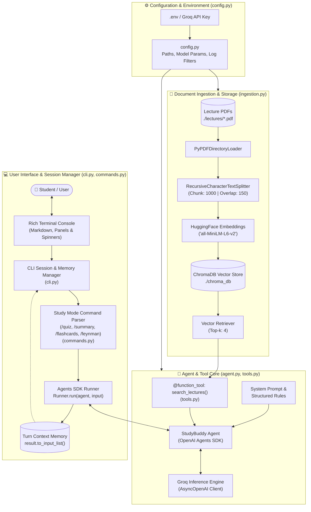
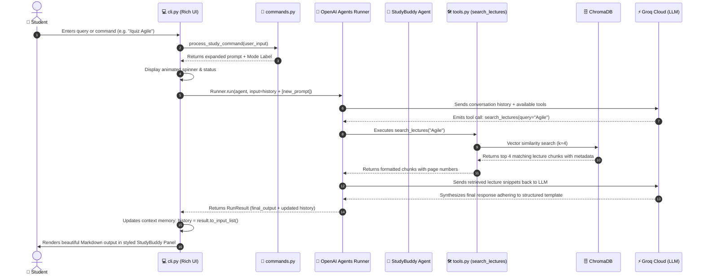

# 🏛️ StudyBuddy: Architecture & System Interaction Guide

This document provides a comprehensive technical breakdown of how **StudyBuddy** works, detailing the architecture, components, and how each subsystem interacts during execution.

---

## 📌 High-Level Architecture Overview

StudyBuddy is a modular, agentic **Retrieval-Augmented Generation (RAG)** system that pairs local vector document retrieval with high-speed LLM reasoning and interactive study modes.

### 1. System Component Architecture

---

### 2. Runtime Execution Sequence Diagram

---

## 🧩 Detailed Component Breakdown

### 1. Configuration & Settings
- **Module**: [config.py](file:///d:/Agent%201.0/config.py)
- **Functionality**:
  - Centralizes all environment variables (`GROQ_API_KEY`, `GROQ_MODEL`).
  - Sets up filesystem paths (`LECTURES_DIR`, `CHROMA_DIR`).
  - Suppresses third-party library log noise and sets UTF-8 encoding for Windows.

---

### 2. Document Ingestion & Vector Storage
- **Module**: [ingestion.py](file:///d:/Agent%201.0/ingestion.py)
- **Libraries**: `PyPDFDirectoryLoader`, `RecursiveCharacterTextSplitter`, `HuggingFaceEmbeddings`, `ChromaDB`
- **Functionality**:
  - Scans `./lectures/` for `.pdf` files and chunks them (1,000 characters with 150-character overlap).
  - Uses `all-MiniLM-L6-v2` locally to produce semantic vector embeddings.
  - Persists vectors to `./chroma_db/` and returns the `retriever`.

---

### 3. Agent Tool Definition
- **Module**: [tools.py](file:///d:/Agent%201.0/tools.py)
- **Functionality**:
  - Defines `@function_tool search_lectures(query: str)` using the OpenAI Agents SDK.
  - Queries ChromaDB and returns structured context with source documents and page numbers.

---

### 4. Agent Setup & Groq LLM
- **Module**: [agent.py](file:///d:/Agent%201.0/agent.py)
- **Functionality**:
  - Configures `AsyncOpenAI` pointing to Groq's high-speed endpoint.
  - Instantiates the `StudyBuddy` Agent with system prompt and search tool binding.

---

### 5. Study Modes & Command Parsing
- **Module**: [commands.py](file:///d:/Agent%201.0/commands.py)
- **Functionality**:
  - Translates study slash commands (`/quiz`, `/flashcards`, `/summary`, `/feynman`) into specialized pedagogical prompts.

---

### 6. Interactive CLI & Session Memory
- **Module**: [cli.py](file:///d:/Agent%201.0/cli.py)
- **Functionality**:
  - Manages conversational history across turns using `result.to_input_list()`.
  - Provides session reset (`/clear`), turn tracking (`/history`), and formatted output.

---

### 7. Entry Point
- **Module**: [main.py](file:///d:/Agent%201.0/main.py)
- **Functionality**:
  - Clean async bootstrap that initializes the vector store, creates the agent, and launches the CLI.

---

## 🔄 End-to-End Execution Sequence

| Step | Initiator | Target | Action / Description |
| :--- | :--- | :--- | :--- |
| **1. Startup** | `main.py` | `ingestion.py` | Ingests PDFs from `./lectures` and loads ChromaDB vector retriever. |
| **2. Agent Build**| `main.py` | `agent.py` & `tools.py` | Wires the retriever to `@function_tool` and configures StudyBuddy with Groq. |
| **3. Prompt** | Student | `cli.py` | User enters a question or slash command (e.g. `/summary Chapter 1`). |
| **4. Command Route**| `cli.py` | `commands.py` | Expands command into a structured prompt with multi-turn history. |
| **5. Plan & Tool** | `Runner` | Groq LLM & `tools.py` | LLM calls `search_lectures(query=...)` to retrieve matching chunks from ChromaDB. |
| **6. Output** | LLM & CLI | Student | Returns synthesized response with source page citations to the terminal. |

---

## 📂 File Map & Dependencies

- [main.py](file:///d:/Agent%201.0/main.py): Clean application entry point.
- [config.py](file:///d:/Agent%201.0/config.py): Environment and paths configuration.
- [ingestion.py](file:///d:/Agent%201.0/ingestion.py): PDF parsing and ChromaDB retriever setup.
- [tools.py](file:///d:/Agent%201.0/tools.py): Agent tools definition.
- [agent.py](file:///d:/Agent%201.0/agent.py): Groq client & Agent initialization.
- [commands.py](file:///d:/Agent%201.0/commands.py): Study modes command processor.
- [cli.py](file:///d:/Agent%201.0/cli.py): Terminal session & conversational memory manager.
- [requirements.txt](file:///d:/Agent%201.0/requirements.txt): Environment dependencies.
- [README.md](file:///d:/Agent%201.0/README.md): Quickstart guide.
- `.env` / [.env.example](file:///d:/Agent%201.0/.env.example): API key configuration.
